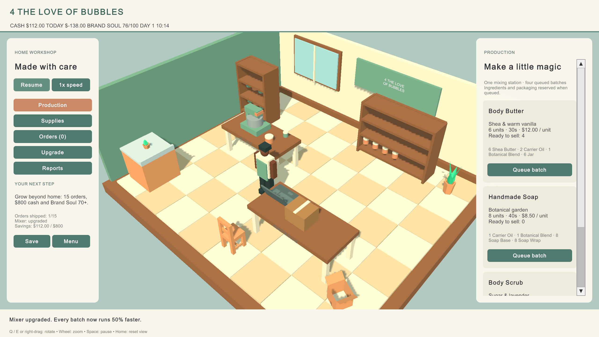

# 4 The Love Of Bubbles

A warm, stylized Unity 3D management game about growing a handmade bath-and-body business from a home workshop into a retail brand.

This repository starts with the **Home Business prototype** from the [development brief](docs/Game-Development-Brief.pdf). Later retail stores, staff and chain management remain future milestones.



## Play in Unity

1. Clone this repository, or use the editable local project at `D:\Unity Projects\4 The Love Of Bubbles`.
2. Add the repository's root folder to Unity Hub and open it with **6000.5.3f1**.
3. Open `Assets/_Project/Scenes/SCN_HomeWorkshop.unity` and press **Play**.
4. Choose **Start a new business** or **Continue saved business**.

The initial project uses the already installed Unity editor rather than installing another editor. This version is not the LTS baseline recommended by the brief; a move to LTS should be evaluated as a separate upgrade. URP 17.5.0, Input System 1.19.0 and Unity UI Toolkit are used. The included uGUI package provides TextMeshPro for later UI/art additions.

## Home workshop loop

- Buy supplier packs of ingredients and packaging, subject to storage capacity and cash.
- Queue Body Butter, Handmade Soap and Body Scrub on one mixing station.
- Watch batches finish in 45, 60 and 40 simulated seconds. Finished products appear on the shelf.
- Pack and ship local/online orders for revenue and Brand Soul.
- Buy a $150 precision mixer for 50% faster production.
- Reach 15 fulfilled orders, $800 cash, the upgraded mixer and Brand Soul 70+ to outgrow home.
- Review the cash ledger, pause, switch between 1x and 3x speed, save and resume.

Click the mixing worktop, ingredient-shelf back or packing worktop to open its inspector. Sidebar buttons provide the same controls. Q/E or right-drag rotate the perspective camera; the mouse wheel zooms. Space pauses, Home resets the view, Escape opens the menu and F3 shows diagnostics. Product shelves display up to 12 units per product as a visual sample; the inspector is the authoritative full count.

## Saves and prototype assumptions

Save schema v1 fixes the ingredient/product catalog order; changing that order requires a schema migration.

Saves use Unity's persistent-data folder, outside the repository. Manual save, a 60-real-second autosave, on-quit save and one rolling backup are supported. Load validates schema v1, stock, queue, orders and the economy ledger before changing the current business. A corrupt primary save falls back to its valid backup. Unknown future versions are rejected without modifying the current business. Future schema migrations must be added when v2 is introduced.

Starting cash is $250; starting ingredients are a gift. Money uses integer cents and a central ledger. Supply packs arrive immediately. One game day lasts five simulated minutes. Orders expire after five simulated minutes; each missed order removes one Brand Soul and each shipment adds one. Four queued batches, five open orders, 240 ingredient/package units and 72 finished/reserved product units keep the workshop constrained. Canceling a batch refunds all supplies and packaging, subject to refund storage space, with no refund of elapsed production time. The mixer speeds up active and queued work. No real cosmetic manufacturing advice is modeled.

Cash profit includes supply and equipment purchases, rather than accrual-based accounting. These are **tunable prototype defaults**, not final business economics or final 30-minute pacing. Founder geometry and product jars are simple prototype stand-ins. Movement, bespoke likeness, audio, packaging polish, recipe variants and marketing belong to the next home-polish milestone.

## Development and validation

Static definitions live in ScriptableObjects under `Assets/_Project/Data`; mutable business state is serialized separately. Simulation services own economy, inventory, production and orders. UI and workshop presentation consume those services. `Bubbles > Run simulation validation` runs deterministic economy, inventory, production, cancel/refund, capacity, speed, upgrade, deadline, milestone, save round-trip and backup-recovery assertions. Verification output is ignored by Git.

```powershell
& 'C:/Program Files/Unity/Hub/Editor/6000.5.3f1/Editor/Unity.exe' -batchmode -quit -projectPath 'D:/Unity Projects/4 The Love Of Bubbles' -executeMethod Bubbles.Editor.Validation.RunAll -logFile 'Verification/tests.log'
```

Use `Bubbles.Editor.ProjectSetup.BuildWindows` as an `-executeMethod` to build a Windows player under ignored `Builds/Windows`. `ProjectSetup.Generate` only scaffolds a new project if its workshop scene does not exist; it does not overwrite the shipped scenes on ordinary import. Keep Unity `.meta` files in every commit. Do not commit Library, Temp, Logs, UserSettings, Builds or player saves.

For runtime button checks, enter Play mode and choose `Bubbles > Play-test UI with Unity input (Play mode)`. This uses engine input events, writes an ignored validation report and captures a gameplay preview. See [validation record](docs/VALIDATION.md) for the completed checks and their limits.

GitHub Actions validates source structure and asset GUIDs without a paid Unity service. Actual Unity compilation/play tests are performed in the installed editor; hosted Unity CI is not configured and would need a licensed runner.

## Assets and rights

Six furniture models come from [Kenney's Furniture Kit](https://kenney.nl/assets/furniture-kit), released under CC0. See [asset provenance](docs/ASSETS.md) and the included original license. No paid assets are required. Project-specific game source and the business identity are not granted an open-source license by this repository; third-party asset licenses remain their own.

## Local cache note

The D: checkout uses a `Library` directory junction to a disposable cache on C: to keep the first Unity import responsive. All editable source is on D:. This cache and initial import backups are ignored by Git; a fresh clone builds its own Library normally.
